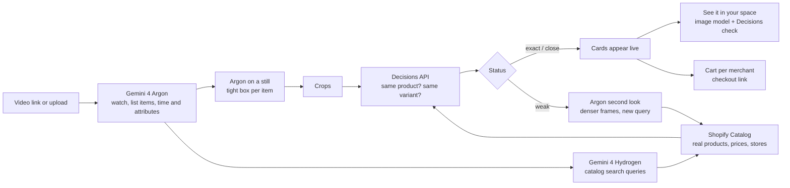

# Seen It

**Every video becomes shoppable, with confidence you can trust.**

Paste a video. Seen It watches it, finds the products in it, matches each one to real Shopify listings, and tells you how sure it is: *exact match*, *close match*, or *no confident match*. When it isn't sure, it looks again. Then it builds the cart, puts the product in your own room, and hands you a real merchant checkout link.

> Built at the Gemini 4 NYC Hackathon (Element 119 track, Shopify bonus). Team: Harsha, Sreeja, Rachael.

---

## The problem

You see a lamp in a video and want it. A text description ("black arc lamp") throws away the exact color, finish and shape that identify it. Reverse image search finds look-alikes across the whole web, with no idea whether *this* product is for sale, on which store, or whether the match is right. And video is the hard input: shaky, fast cuts, half-hidden items, bad light.

## What it does

1. **Finds the products.** Gemini 4 Argon watches the video (a link, or a local video file) and lists every purchasable item with attributes and the best moment to see it. A second pass on a still frame draws a tight box around each item, so the crop is the product and not the wall.
2. **Searches real catalogs.** Each item becomes a search query (written by Gemini 4 Hydrogen) against Shopify's global catalog, which returns real products, prices and stores.
3. **Verifies, with a probability.** The Decisions API (`gemini-decision-1`) scores every candidate on two questions: *same product?* and *same color/variant?*. Those scores become the label you see. We don't hardcode a confidence; the model gives a calibrated one.
4. **Recovers when it's unsure.** For weak matches, Argon takes a second look at denser frames around the item, picks the clearest view, rewrites the query, and we search and check again. The card says **"Second look improved this"** only when the status really went up.
5. **Says "no" honestly.** If nothing matches, the card reads *No confident match. We'd rather say so than guess.* No invented products.
6. **Puts it in your space.** Upload a photo or video of your room (iPhone photos included), tap where the product should go, and the Gemini image model places it there. The Decisions API then checks the result against the real product photo and your original scene.
7. **Builds the cart.** One real cart per merchant, with a link into that merchant's checkout. We stop there: no orders are ever placed.

## How it works



| Model | Its one job |
|---|---|
| **Gemini 4 Argon** | Understands the video: items, timestamps, attributes, boxes on stills, and the second look |
| **Gemini 4 Hydrogen** | Turns each item into a sharp catalog search query (fast, runs alongside box detection) |
| **Decisions API** (`gemini-decision-1`) | Gives the probabilities behind every label, and checks each room preview. It takes several images in one call, which we rely on. |
| **Gemini image model** (`gemini-nano-banana-2.1`) | Places the product into your own photo |

We deliberately did **not** use Gemini 4 Carbon (restricted access).

## It is an agent, not an analyzer

It doesn't just describe a video. It **acts**: searches real stores, verifies its own matches with calibrated scores, notices when it's unsure, retries with better evidence, and finishes the job at a checkout link. The interface is video-first (the video, the items found in it, one decision per item). There is no dashboard and no chat box.

## What we measured, honestly

We tested on a real, unscripted desk-setup video from YouTube, run many times, plus other clips for the room preview. These are timings from our own runs, not claims from a labeled benchmark.

- **Speed.** Item cards appear in about **15 s** (up to ~40 s on a slow run); matches fill in from about **25 s**; a full 10-item run takes roughly **50 to 60 s**. Cards stream in as each finishes, so you never stare at a spinner. A room preview takes about **15 to 17 s**.
- **The second look matters.** Across our runs of the same video it upgraded between **0 and 6** of 10 items, for example 2 exact matches rising to 8 in one run. It never replaces a result unless the status improves.
- **Where it breaks.**
  - Argon is not deterministic: the item list changes between runs and is capped at 10.
  - Small or half-hidden items (a keyboard, a mouse) sometimes get no usable box, so we keep the full frame.
  - An "exact" label means the checker is confident, not that a human confirmed it. We have not published a labeled accuracy number.
  - The room-preview check is strict: believable images often score 0.6 to 0.8. We show a plain-words verdict and never hide a result.
  - Without a Shopify client key, catalog search is rate limited, and we retry with backoff.
- **Evaluation harness.** `eval/` contains the runner, metrics (match accuracy, calibration, baseline comparison) and charts. It needs labeled videos to produce numbers; we are not claiming any.

## Built to be safe to demo

- **No real orders.** We create carts and stop at the merchant's checkout link.
- **No catalog caching and no re-hosted images.** Merchant photos are fetched into memory only to run a check, and the UI loads them from the merchant. Saved runs keep only IDs and scores.
- **Your photos** go to our server and to Gemini to make the preview. They are kept locally and not shared with Shopify.
- **Keys stay on the server.** Nothing secret reaches the browser, and logs redact keys and strip inline media.

## Try it

You need Python 3.11+, Node 20+, and `ffmpeg`. Copy `.env.example` to `.env`, add your Gemini API key (the Shopify agent profile line is already filled in).

```bash
# backend
python3 -m venv .venv && .venv/bin/pip install -r requirements.txt
.venv/bin/uvicorn backend.api:app --port 8010

# web (second terminal)
cd web && npm install
API_PROXY_TARGET=http://localhost:8010 NEXT_PUBLIC_API_URL=/backend npm run dev
```

Open <http://localhost:3000>, paste a video link, press **Find products**, and click an item to see the match, the store link, and **See it in your space**.

## Repo map

| Path | What's there |
|---|---|
| `backend/video/` | Video understanding: extraction, boxes, second look, room preview |
| `backend/matching/` | Catalog search, Decisions checks, status logic |
| `backend/shopify/` | Shopify Catalog and Cart clients |
| `backend/api.py` | The thin API the web app talks to |
| `web/` | The Next.js interface |
| `contracts/` | The shared data contract between the three of us |
| `eval/` | Evaluation harness |
| `CLAUDE.md`, `AGENT_RULES.md` | How we built it (for contributors) |
