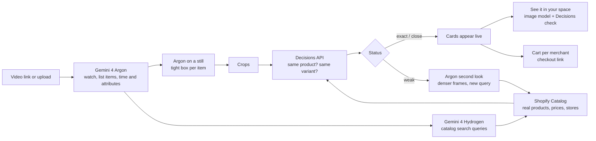

# Seen It

**Every video becomes shoppable, with confidence you can trust.**

Paste a video. Seen It watches it, finds the products in it, matches each one to real Shopify listings, and tells you how sure it is: *exact match*, *close match*, or *no confident match*. When it isn't sure, it looks again. Then it builds the cart, puts the product in your own room, and hands you a real merchant checkout link.

> Built at the Gemini 4 NYC Hackathon (Element 119 track, Shopify bonus). Team: Harsha, Sreeja, Rachael.

---

## The problem

You see a lamp in a video and want it. A text description ("black arc lamp") throws away the exact color, finish and shape that identify it. Reverse image search finds look-alikes across the whole web, with no idea whether *this* product is for sale, on which store, or whether the match is right. And video is the hard input: shaky, fast cuts, half-hidden items, bad light.

## What it does

1. **Finds the products.** Gemini 4 Argon watches the video (a link, or a local video file) and lists every purchasable item with attributes and the best moment to see it. A second pass on a still frame draws a tight box around each item, so the crop is the product and not the wall.
2. **Searches real catalogs.** Each item becomes a search query (written by Gemini 4 Hydrogen) against Shopify's global catalog, which returns real products, prices and stores.
3. **Verifies, with a probability.** The Decisions API (`gemini-decision-1`) scores every candidate on two questions: *same product?* and *same color/variant?*. Those scores become the label you see. We don't hardcode a confidence; the model gives a calibrated one.
4. **Recovers when it's unsure.** For weak matches, Argon takes a second look at denser frames around the item, picks the clearest view, rewrites the query, and we search and check again. The card says **"Second look improved this"** only when the status really went up.
5. **Says "no" honestly.** If nothing matches, the card reads *No confident match. We'd rather say so than guess.* No invented products.
6. **Puts it in your space.** Upload a photo or video of your room (iPhone photos included), tap where the product should go, and the Gemini image model places it there. The Decisions API then checks the result against the real product photo and your original scene.
7. **Builds the cart.** One real cart per merchant, with a link into that merchant's checkout. We stop there: no orders are ever placed.

## How it works



| Model | Its one job |
|---|---|
| **Gemini 4 Argon** | Understands the video: items, timestamps, attributes, boxes on stills, and the second look |
| **Gemini 4 Hydrogen** | Turns each item into a sharp catalog search query (fast, runs alongside box detection) |
| **Decisions API** (`gemini-decision-1`) | Gives the probabilities behind every label, and checks each room preview. It takes several images in one call, which we rely on. |
| **Gemini image model** (`gemini-nano-banana-2.1`) | Places the product into your own photo |

We deliberately did **not** use Gemini 4 Carbon (restricted access).

## It is an agent, not an analyzer

It doesn't just describe a video. It **acts**: searches real stores, verifies its own matches with calibrated scores, notices when it's unsure, retries with better evidence, and finishes the job at a checkout link. The interface is video-first (the video, the items found in it, one decision per item). There is no dashboard and no chat box.

## What we built, in one day

About **6,100 lines of Python** (FastAPI backend, video understanding, matching, Shopify clients), **2,700 lines of TypeScript** (the Next.js interface), **94 tests**, **8 API endpoints** and a shared data contract between three people. One full run makes about **30 Gemini calls across four model roles**: in a typical 10-item run, 1 video pass, 4 still-frame box passes, 1 query-writing call, 18 Decisions API checks and 8 second looks.

## How Gemini 4 made it work: the technical details

Each of these started as a failure we measured, and a model-level fix.

**1. Boxes from a still, not from the video.** Asking Argon for bounding boxes while it watches the video gave boxes that were roughly in the right place but wrong: a monitor box far too tall, a clock 40 px too high, crops that showed the wrong object. The same model is precise on a single image. So extraction is two passes: Argon watches the video for *what and when*, then ffmpeg pulls one frame per timestamp and Argon boxes the products on that still (0 to 1000 scale), grouped by frame and run in parallel. Items it can't box keep the full frame, so nothing is lost.

**2. A query writer that costs no time.** Argon's labels are descriptions, not search queries. One batched call to Gemini 4 Hydrogen rewrites every item into a catalog query (product type first, the attributes that narrow it, no guessed brands). It runs concurrently with the box pass, so it adds roughly zero seconds to the run.

**3. Probabilities, not vibes.** The Decisions API gates every candidate with two questions, *same product?* and *same color/variant?*. It returns a probability per question with **zero output tokens** (about 2.5 s per batched call). Thresholds live in config, not in code, and they turn probabilities into the exact, close and no-match labels you see. We confirmed it accepts several images in one call, and we use that to verify room previews.

**4. A second look that can only help.** For a weak match, Argon receives **nine frames within two seconds of the item**, picks the clearest, boxes the product again, and rewrites the description and query (and is told not to guess a brand it can't read). We search and check again once. The new result replaces the old one **only if the status improves**, so a second look can never make a card worse, and the badge appears only when something truly got better. It runs in a time-boxed background pass, so slow cases never block the cards that are ready.

**5. Speed as an architecture decision.** The whole run was reshaped around time to first useful result:
- Matching is split into a fast first pass (cards appear as each finishes) and a time-boxed second look. Matches now appear from about 28 s instead of after the whole run.
- Parallel workers cut matching from about 100 s to about 36 s on the same video.
- Small local videos go to Argon inline instead of through the Files API (extraction 33 s to 25 s).
- Repeat clicks return the run already in progress, so duplicate requests can't slow everything down.
- Room-preview images are shrunk before generation, cutting the image model from **58 s to 14 s** per preview.

**6. Prompting the image model.** The first room previews copied the product photo's background. The final prompt tells the model the reference photo is only for shape and color, to ignore its room, and to keep the user's scene exactly as it is. The user can tap where the product goes, which becomes a position hint. A Decisions check scores two things on the result (does the product look like the reference, and is the scene preserved) and we take the lower one, so a pretty but wrong image can't pass.

**7. Plain engineering that matters.** Shopify's hosted example agent profile doesn't declare catalog search, so every search returned "Tool not found"; we found it by reading the discovery response and switched profiles. iPhone HEIC photos are converted on upload. The first-pass/second-look budget is measured from when matching ends, after our own baseline check showed a slow extraction could eat the second look entirely.

## Baseline check

We built the simple alternative, [`eval/baseline.py`](eval/baseline.py): one middle frame, one Gemini call, search each label, **take the top result with no checking**. We ran both on the same real, unscripted video and compared them by eye, item by item. The full table is in [`docs/BASELINE_CHECK.md`](docs/BASELINE_CHECK.md).

| | Single-shot baseline | Seen It |
|---|---|---|
| Time | 10 s | 68 s (first matches at about 28 s) |
| Gemini calls | 1 | 32 |
| Items | 9 | 10 |
| Looks right, by eye | about 4 of 9 | about 7 of 10 |
| Clearly wrong | 3 of 9, **with no warning** | 0 shown as wrong without a label; 2 "exact" labels over-confident on a detail |
| Tells you how sure it is | No | **Yes**: every item is exact, close or no match |

The honest read: the baseline is 7x faster and fine on simple, distinctive items. Its mistakes are silent: it returned a white HomePod for a dark Echo and the wrong style of clock, with the same confidence as everything else. Seen It's checks make the uncertainty visible, and its second look rescued an item the first pass missed (the monitor light bar went from no match to exact). This is **one video and judged by eye, not a labeled benchmark**, so we claim a worked example, not a percentage.

## Where it breaks

- Argon is not deterministic: the item list changes between runs and is capped at 10.
- "Exact" means the checker is confident, not that a human confirmed it. In our check, two of four exact labels were generous on a color or model detail, and one correct product was missed by being too cautious on a tiny, dark crop.
- Tiny or half-hidden items sometimes get no usable box, so we fall back to the full frame.
- The room-preview check is strict: believable images often score 0.6 to 0.8. We show a plain-words verdict and never hide the result.
- Without a Shopify client key, catalog search is rate limited; we retry with backoff.
- The evaluation harness in [`eval/`](eval/) is ready for labeled videos; we are not claiming a labeled accuracy number.

## Built to be safe to demo

- **No real orders.** We create carts and stop at the merchant's checkout link.
- **No catalog caching and no re-hosted images.** Merchant photos are fetched into memory only to run a check, and the UI loads them from the merchant. Saved runs keep only IDs and scores.
- **Your photos** go to our server and to Gemini to make the preview. They are kept locally and not shared with Shopify.
- **Keys stay on the server.** Nothing secret reaches the browser, and logs redact keys and strip inline media.

## Try it

You need Python 3.11+, Node 20+, and `ffmpeg`. Copy `.env.example` to `.env`, add your Gemini API key (the Shopify agent profile line is already filled in).

```bash
# backend
python3 -m venv .venv && .venv/bin/pip install -r requirements.txt
.venv/bin/uvicorn backend.api:app --port 8010

# web (second terminal)
cd web && npm install
API_PROXY_TARGET=http://localhost:8010 NEXT_PUBLIC_API_URL=/backend npm run dev
```

Open <http://localhost:3000>, paste a video link, press **Find products**, and click an item to see the match, the store link, and **See it in your space**.

## Repo map

| Path | What's there |
|---|---|
| `backend/video/` | Video understanding: extraction, boxes, second look, room preview |
| `backend/matching/` | Catalog search, Decisions checks, status logic |
| `backend/shopify/` | Shopify Catalog and Cart clients |
| `backend/api.py` | The thin API the web app talks to |
| `web/` | The Next.js interface |
| `contracts/` | The shared data contract between the three of us |
| `eval/` | Single-shot baseline, evaluation harness and metrics |
| `CLAUDE.md`, `AGENT_RULES.md` | How we built it (for contributors) |
